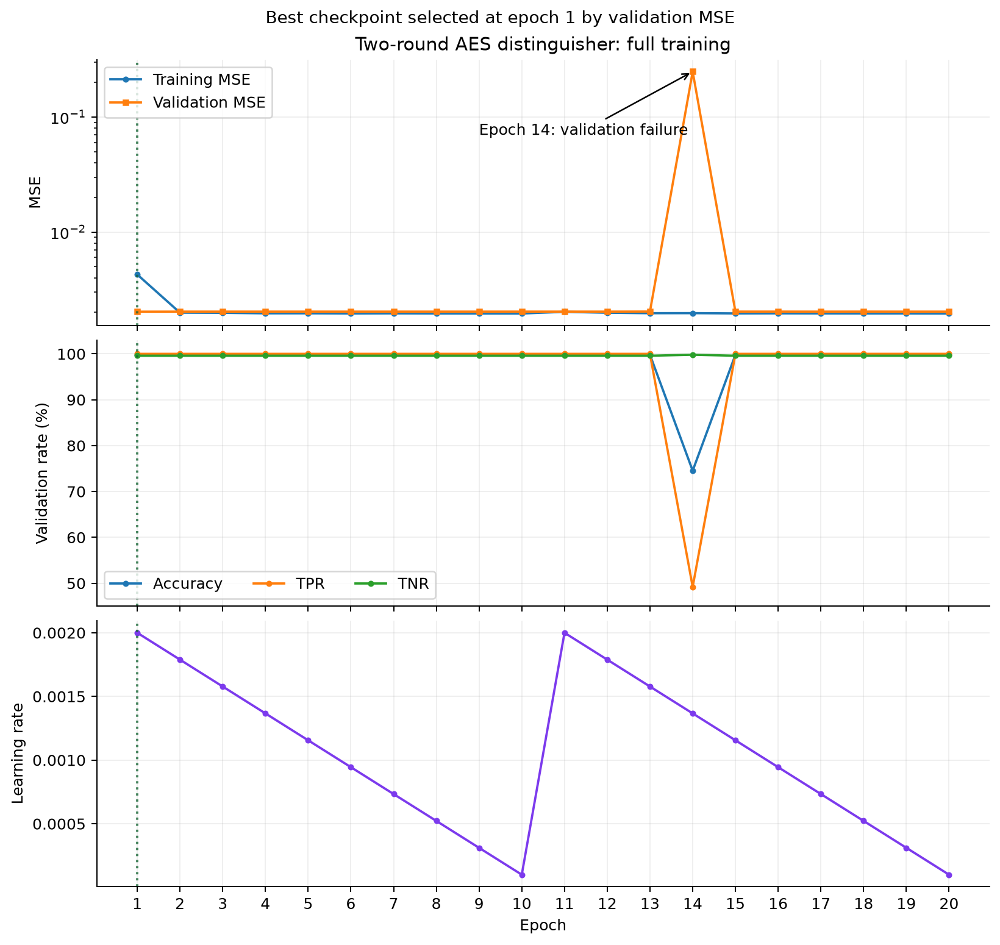
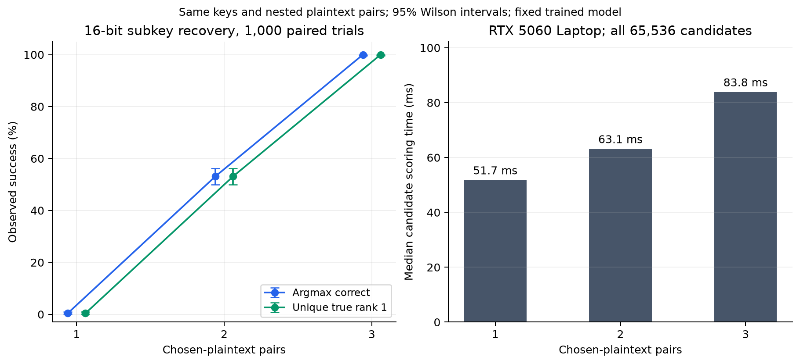

# AES Neural Distinguisher — PyTorch 复现与子密钥恢复

参考 Liu Zhang、Zilong Wang、Jinyu Lu 的 [Differential-Neural Cryptanalysis on AES（IEICE 2024）](https://doi.org/10.1587/transinf.2024EDL8044)，用 PyTorch 实现两轮 AES 双字节神经区分器，并验证三轮 AES 的 16 位末轮子密钥恢复。

**当前结果：两轮区分器在新生成的 100 万样本上准确率 0.998057；三对选择明文下，1,000 次部分子密钥恢复均正确且唯一第一。**

本项目是独立实现的**指标复现**。当前输入布局、正则化与验证损失定义和作者 Keras 代码存在差异，不是逐层等价移植；也没有破解完整轮 AES 或恢复完整 128 位主密钥。详见 [复现学习记录](docs/复现学习记录.md)。

本仓库沿用 [Speck 复现项目](https://github.com/superdora214/gohr_pytorch_reproduce)的组织方式：结果总览 → 快速开始 → 训练曲线 → 方法说明 → 原始实验记录。

## 背景

区分器输入一对密文的指定字节，判断它们来自规定输入差分，还是随机明文对。训练时每条样本独立随机选择密钥；模型不接收密钥。

本任务使用第 0 字节的输入差分 `0x80`。两轮加密均包含 MixColumns，取每侧密文的第 `{0,1}` 字节，合计 32 位。攻击时则使用第三轮省略 MixColumns 的三轮设定。

## 核心结果（论文基准与本复现）

| 结果来源 | 测试样本 | Acc | TPR | TNR |
|---|---:|---:|---:|---:|
| 论文表 5，双字节 `{0,1}` | 论文设定 | 0.9980 | 1.0 | 0.9961 |
| 完整训练后的云端独立测试 | 1,000,000 | 0.998053968 | 1.0 | 0.996100307 |
| 本机重新生成数据的独立测试 | 1,000,000 | **0.998057** | **1.0** | **0.996114303** |
| 同一本机数据上的显式差分规则 | 1,000,000 | 0.998069 | 1.0 | 0.996138301 |

数值接近支持指标复现，不表示优于论文或实现完全相同。显式规则与网络仅有 12 个判别结果不同；这支持模型行为与已知差分关系高度一致，不能据此确定网络内部只使用这一关系。

### 进度总览

| 环节 | 状态 |
|---|---|
| AES 标准向量、缩减轮对照、输入不变性检查 | 通过 |
| 两轮双字节区分器完整训练 | 1,000 万样本，20 epoch |
| 最佳模型独立测试及哈希绑定 | 已完成 |
| 三轮 AES 的 16 位末轮子密钥恢复 | 已完成 1/2/3 对明文配对对照 |
| 作者原版架构逐层复刻 | 未完成；差异已记录 |
| 全部字节区分器、完整主密钥恢复、更高轮攻击 | 本项目尚未验证 |

## 环境要求

- Python 3.11+，PyTorch 2.6+；绘图需要 NumPy 和 Matplotlib。
- 正式训练：RTX 4080 SUPER，Python 3.12.3，PyTorch 2.8.0+cu128。
- 补充测试：RTX 5060 Laptop GPU，PyTorch 2.13.0+cu130。
- 小规模推理与攻击可用 `--device cpu`；大规模训练建议使用 CUDA。

```bash
pip install -r requirements.txt
```

CUDA 版 PyTorch 请按本机驱动和 [PyTorch 官方安装说明](https://pytorch.org/get-started/locally/)选择，不照搬另一台机器的 CUDA 版本。

## 快速开始

```bash
# 1. 验证 AES；Windows 终端使用 UTF-8，避免勾号打印报错
python -X utf8 test_aes.py

# 2. 小规模训练检查；不要用其准确率代替完整规模结果
python train.py --rounds 2 --bytes 0,1 --train-size 200000 --eval-size 20000 --test-size 20000 --epochs 2 --batch-size 1000 --device cuda --outdir runs/quick_check

# 3. 使用仓库随附的最佳权重，恢复三轮 AES 的 16 位末轮子密钥
python key_recovery.py --checkpoint checkpoints/net_r2b01.pt --trials 100 --pairs 3 --seed 20261028 --device cuda

# 4. 重做新数据分类测试和同一批密钥上的 1/2/3 对明文比较
python evaluate_experiments.py --checkpoint checkpoints/net_r2b01.pt --outdir runs/paired_review --trials 1000 --samples 1000000 --device cuda

# 5. 根据已归档结果重画两张图
python plot_log.py
```

`--outdir` 用于评估时必须尚不存在，避免覆盖旧实验。固定种子不保证跨 PyTorch 版本和 GPU 逐位一致，报告中记录了运行环境。

## 正式训练与曲线

```bash
python train.py --rounds 2 --bytes 0,1 --train-size 10000000 --eval-size 1000000 --test-size 1000000 --epochs 20 --batch-size 1000 --depth 5 --period 9 --lr-high 0.002 --lr-low 0.0001 --l2 0.00001 --seed 20261024 --device cuda --save-every-epoch --outdir runs/full_r2
```

模型使用 MSE、Adam 和全参数 weight decay；学习率每 10 个 epoch 循环一次。按验证集纯 MSE 最低选模型，再用新的测试集评价。训练入口从头训练，当前没有完整优化器状态续训功能。



20 轮耗时合计约 48.32 分钟，不包括整个实例开机时间。最佳模型来自第 1 轮，此时已完成 10,000 次优化更新。第 14 轮验证性能短暂下降，保存的权重在新数据上也只有 0.744705 准确率；第 15 轮恢复。异常原因尚未定位，最终使用的第 1 轮权重没有该问题。

## 神经密钥恢复攻击

```text
三轮密文（第三轮无 MixColumns）
        ↓ 枚举 K3 的字节 {0,13}，共 65,536 个候选
        ↓ 候选末轮逆运算
两轮中间状态的字节 {0,1}
        ↓ 两轮区分器评分，累加多对数据的对数几率
候选排名 → 事后与真实子密钥比较
```

由于 ShiftRows，训练字节 `{0,1}` 对应的末轮密文/轮密钥位置是 `{0,13}`。打分函数只接收密文和模型，不接收真实密钥。

| 选择明文对数 | 加密查询数 | 正确且唯一第一 | 观测成功率 | 95% Wilson 区间 |
|---:|---:|---:|---:|---:|
| 1 | 2 | 4/1000 | 0.4% | 0.156%–1.024% |
| 2 | 4 | 531/1000 | 53.1% | 50.001%–56.175% |
| 3 | 6 | **1000/1000** | **100%** | 99.617%–100% |



三组使用同一批随机密钥及嵌套的明文对，固定模型不变。100% 是这批实例中的观测结果，不能解释为所有实例必然成功。详细方法见 [密钥恢复攻击说明](docs/密钥恢复攻击说明.md)，原始结果见 [实验目录](docs/experiments/20261024/)。

## 方法要点与学习入口

```text
输入 [N,32] → view [N,4,8]
→ 1×1 Conv（16 通道）+ BN + ReLU
→ 5 个残差块（两层宽度 3 的卷积）
→ Flatten → Dense(64) → Dense(64) → Sigmoid
```

当前模型参数量为 21,009。作者原版双字节布局是 `[N,2,16]`（通道优先形式），与这里不同；Keras kernel L2 和本实现的 Adam weight decay，以及验证损失口径，也存在区别。

- [项目全景与原理详解](项目全景与原理详解.md)：按数据、网络、训练、攻击顺序读代码。
- [复现学习记录](docs/复现学习记录.md)：全过程、异常和结论边界。
- [密钥恢复攻击说明](docs/密钥恢复攻击说明.md)：位置映射、评分、排名和成功定义。
- [原始实验记录](docs/experiments/20261024/README.md)：参数、种子、指标、逐次结果和源代码版本。

## 项目结构

```text
src/aes/aes.py                 # 批量 AES、密钥编排、有限域运算
src/data/dataset.py            # 正负样本及位编码
src/model/distinguisher.py     # 当前已训练模型的结构
train.py                      # 训练、验证、最佳权重、最终测试
key_recovery.py               # 单个明文对数量设置的攻击
evaluate_experiments.py        # 分类与配对攻击评估
plot_log.py                   # 已归档实验的结果图
checkpoints/net_r2b01.pt       # 本次正式训练的最佳权重
docs/                         # 图表、学习笔记、实验记录
requirements.txt
```

只随附一份可直接复测的最佳权重；20 轮权重和完整本机归档另行保留。公开目录不包含个人 SSH 配置、云端连接信息、下载路径或第三方论文 PDF。

## 参考

- Liu Zhang, Zilong Wang, Jinyu Lu. *Differential-Neural Cryptanalysis on AES*. IEICE E107-D(10), 1372–1375, 2024. [DOI](https://doi.org/10.1587/transinf.2024EDL8044)。
- [作者源码固定提交](https://github.com/CryptAnalystDesigner/differential-neural-cryptanalysis-on-aes/tree/6556c7b53f25eca35785c738c9834d2b09ff39a0)。本仓库没有复制作者训练代码。
- 本仓库的学习笔记由 AI 辅助整理，原始数值以对应 JSON/CSV 为准；用于论文或正式汇报前，应由本人复核方法和表述。
